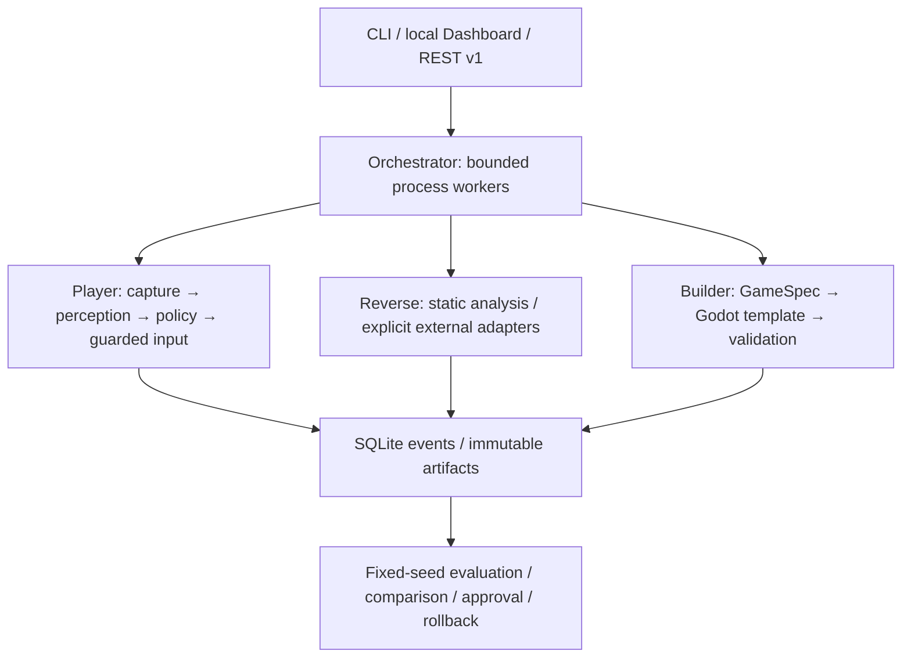

# Architecture

UGA is a local Python monorepo for authorized game testing. Python 3.11 is the target;
Python 3.12 is supported. GPU/model providers are optional. No paid API is required.

`src/uga/` holds importable packages corresponding to the requested agents and shared
packages. Root `test_games/`, `benchmarks/`, `configs/`, `scripts/`, `tests/`, and `docs/`
hold reproducible inputs and tools. This avoids ambiguous top-level names such as
`core` and `packages`, and permits one installable wheel and independent agent commands.

All wire contracts are versioned Pydantic models. Observations carry confidence,
source and UTC timestamps. Unknown measurements remain `null`. Schema exports are
generated with `uga schemas`. New incompatible wire changes require a schema version bump.

Fast control is independent of slow strategic/model inference. Workers isolate builds
and analysis from player loops. SQLite WAL holds job/event/checkpoint metadata;
content-addressed artifacts are verified on read. No arbitrary code is accepted through
the API. External AI integration uses registry/protocol interfaces without a live connection.
